# ACE — Architecture Document

| | |
|---|---|
| **Product** | ACE — Multimodal AI Agent Orchestration Platform |
| **Version** | 2.0 |
| **Owner** | Mouli Lohani |
| **Status** | Draft for review |
| **Companion docs** | ACE FRS (requirements + test cases) · ACE Build Blueprint (full API list, phase detail) · DECISIONS.md |

---

## Table of Contents
1. Introduction
2. Goals, Non-Goals, Constraints, Assumptions
3. Architectural Principles and Rules
4. Quality Attributes
5. Coverage Check Against the 8-Layer Reference
6. System Context
7. Deployment Modes
8. Layered Architecture
9. Container View
10. Layer 1 — Client
11. Layer 2 — API Gateway
12. Layer 3 — Orchestration
13. Guardrails
14. Layer 4 — Model Serving
15. Layer 5 — Data
16. Layer 6 — Tools
17. Layer 7 — Training / Fine-Tuning
18. Layer 8 — Infra and Ops
19. State Machines
20. API Architecture
21. Key Flows
22. Security Architecture
23. Multi-Tenancy (Hosted)
24. Scalability and Performance
25. Reliability and Disaster Recovery
26. Observability
27. Cost Architecture
28. Error Handling Model
29. Configuration and Environments
30. Code Organization
31. Testing Architecture
32. Versioning and Migration
33. User Flow
34. Roadmap: Layers × Phases
35. Technology Stack
36. Architecture Decision Records
37. Deviations From the Reference Model
38. Risks
39. Open Decisions

---

## 1. Introduction

### 1.1 Purpose
This document describes **how ACE is built**: its layers, components, data, interfaces, deployment, security, and operations. It is the technical reference for everyone building ACE. The FRS says *what* ACE does; this document says *how*.

### 1.2 Scope
All eight platform layers (client, gateway, orchestration, model serving, data, tools, training, infra/ops), guardrails, local and hosted deployment, and the user journey.

### 1.3 Audience
Developers, reviewers, testers, and anyone deciding on infrastructure.

### 1.4 Glossary

| Term | Meaning |
|---|---|
| Canvas | Visual workspace where workflows are built and run |
| Node | Unit on the Canvas: agent, model, input, output, merge, transform, retrieval, guardrail, custom |
| Port | Typed input/output handle on a node |
| Edge | Arrow from an output port to an input port; `data` or `loop` |
| Envelope | Validated package passed along an edge: reads + bounded context + output contract |
| Artifact | Stored file/media, referenced by content hash |
| Provider | Source of models: cloud API, local server, CLI, custom endpoint |
| Run / Node run | One workflow execution / one node execution inside it |
| Engine | Backend that owns all state and executes workflows |
| Guardrail | Policy check on data entering or leaving models and tools |
| Arm | One configuration compared in ACE Bench |

---

## 2. Goals, Non-Goals, Constraints, Assumptions

### 2.1 Goals
- G1. Build, run and debug multi-agent, multi-model, multimodal workflows entirely from a Canvas.
- G2. Stay provider-agnostic: cloud, local and custom models side by side.
- G3. Make every handoff explicit, validated and inspectable.
- G4. Ship locally first (web → desktop) with a clean path to a hosted version.
- G5. Prove value with a governed benchmark (ACE Bench).
- G6. Keep users safe through guardrails, budgets and permissions.

### 2.2 Non-goals (v1)
Self-improving ACE (spec §40) · hosted multi-user service · real-time co-editing · node/skill marketplace · auto-generated agent teams · training our own foundation models.

### 2.3 Constraints
- The UI never holds the source of truth.
- Local engine accepts only local connections.
- Nodes exchange envelopes, never raw history.
- TypeScript for all product code; Python only for optional training.
- Provider quotas and pricing are outside ACE's control.

### 2.4 Assumptions
Users bring their own keys or local models · Git is installed for workspace features · machines have at least 8 GB RAM (16 GB for local models).

---

## 3. Architectural Principles and Rules

| # | Principle / rule | Consequence |
|---|---|---|
| P1 | Canvas first | Every major action reachable from the Canvas |
| P2 | Engine owns truth | UI is a projection of engine state and events |
| P3 | Envelopes, not history | Bounded context, lower cost, reproducible handoffs |
| P4 | Contracts everywhere | One Zod schema set for API, WebSocket, envelopes, DB validation |
| P5 | Distinct states | `CONTRACT_VIOLATION`, `RUN_FAILED`, `BLOCKED`, (`GUARDRAIL_VIOLATION`, D9) are never merged; `COMPLETE` ≠ `HALTED` |
| P6 | Immutable runs | Snapshot at dispatch; append-only events |
| P7 | Ports and adapters | Storage, queue, secrets, providers, tools behind interfaces → local and hosted modes share code |
| P8 | Visible architecture | Retrieval and guardrails can be real nodes on the Canvas |
| P9 | Safe by default | Guardrails, budgets, permissions on unless the user relaxes them |
| P10 | Governed measurement | Frozen bench tasks, blind judging, pre-registered rules |

---

## 4. Quality Attributes

| Attribute | Target | How the architecture achieves it |
|---|---|---|
| Performance | Canvas ≈60 fps at 200 nodes; UI response <100 ms; engine overhead <50 ms/node; stream latency <200 ms | React Flow virtualization, batched graph ops, WebSocket streaming, in-process scheduler |
| Scalability | Local: 20 concurrent node runs · Hosted: horizontal workers | Queue-based dispatch; stateless workers; Redis pub/sub |
| Reliability | No lost events; crash leaves no half-written graph | Transactions, append-only event log, resume-from-sequence |
| Availability (hosted) | 99.5% monthly | Multiple replicas, managed DB with failover |
| Security | No secrets at rest in plaintext; local-only binding | Keychain/secret manager, token + origin checks, sandboxing |
| Safety | Unsafe actions blocked or confirmed | Guardrails engine at 7 points |
| Maintainability | ≥80% engine coverage; one language | TypeScript monorepo, shared contracts |
| Portability | Web → desktop without rewrite | SPA + Node engine; no browser APIs in engine |
| Observability | Every run fully traceable | Event log, traces, Langfuse, metrics |
| Usability | WCAG AA; actionable errors | Design system, error taxonomy |
| Cost efficiency | Predictable spend | Bounded context, caching, budgets, router |

---

## 5. Coverage Check Against the 8-Layer Reference

| Reference item | Covered? | Where | Notes |
|---|---|---|---|
| **1. Web app** | ✅ | §10.1 | Vite SPA for the app; Next.js for the public site (ADR-003) |
| Mobile | ✅ | §10.3 | Responsive monitoring app first; native later |
| CLI | ✅ | §10.4 | `ace` command |
| SDK | ✅ | §10.5 | TypeScript SDK generated from contracts |
| **2. Auth** | ✅ | §11 | Local token; hosted accounts, OAuth, API keys |
| Rate limiting | ✅ | §11 | Per provider (local), per user/key (hosted) |
| Usage metering | ✅ | §11, §27 | Per node run → per workspace |
| FastAPI / Kong / Nginx | ✅ (adapted) | §11 | Hono gateway + Caddy/Nginx; Kong optional (ADR-004) |
| **3. Prompt management** | ✅ | §12.5 | Assembly order, versions, library |
| RAG pipeline | ✅ | §12.6 | Hybrid search, retrieval node |
| Agents | ✅ | §12.7 | Agent nodes + tool loop |
| Tool calling | ✅ | §12.7, §16 | Registry, permissions |
| Memory | ✅ | §12.8 | Short-term, long-term, knowledge |
| Guardrails | ✅ | §13 | 7 guardrail points + Guardrail node |
| LangGraph / LlamaIndex / custom | ✅ (custom) | §12 | ADR-002 |
| **4. vLLM / TGI** | ✅ | §14 | Hosted mode, optional |
| Ollama | ✅ | §14 | Local mode |
| Model router | ✅ | §14.3 | 5 routing policies |
| **5. Vector DB** | ✅ | §15 | sqlite-vec → pgvector → Qdrant if needed |
| Postgres | ✅ | §15 | Hosted |
| Redis | ✅ | §15 | Hosted cache, queue, pub/sub, rate limits |
| Object storage | ✅ | §15 | Local folder → S3-compatible |
| **6. Code sandbox** | ✅ | §16 | Child process / Docker / microVM |
| Web search | ✅ | §16 | SearXNG default |
| File parsers | ✅ | §16 | PDF, DOCX, HTML, media |
| External APIs | ✅ | §16 | HTTP tool + MCP |
| **7. Data pipeline** | ✅ | §17 | From graded bench data |
| LoRA / QLoRA | ✅ | §17 | Optional, post-v1 |
| Eval harness | ✅ | §17 | ACE Bench |
| Model registry | ✅ | §17 | Versions + metrics |
| **8. GPUs** | ✅ | §18 | Only for hosted open models |
| Kubernetes | ✅ | §18 | Hosted, when scale requires |
| Queue (Celery/Kafka) | ✅ (adapted) | §18 | BullMQ; Kafka if event volume demands (ADR-006) |
| Langfuse | ✅ | §26 | LLM traces and prompt versions |
| Prometheus | ✅ | §26 | Metrics + Grafana |

Additional items not in the reference but required: user flow (§33), security threat model (§22), multi-tenancy (§23), disaster recovery (§25), cost model (§27), versioning (§32), ADRs (§36).

---

## 6. System Context

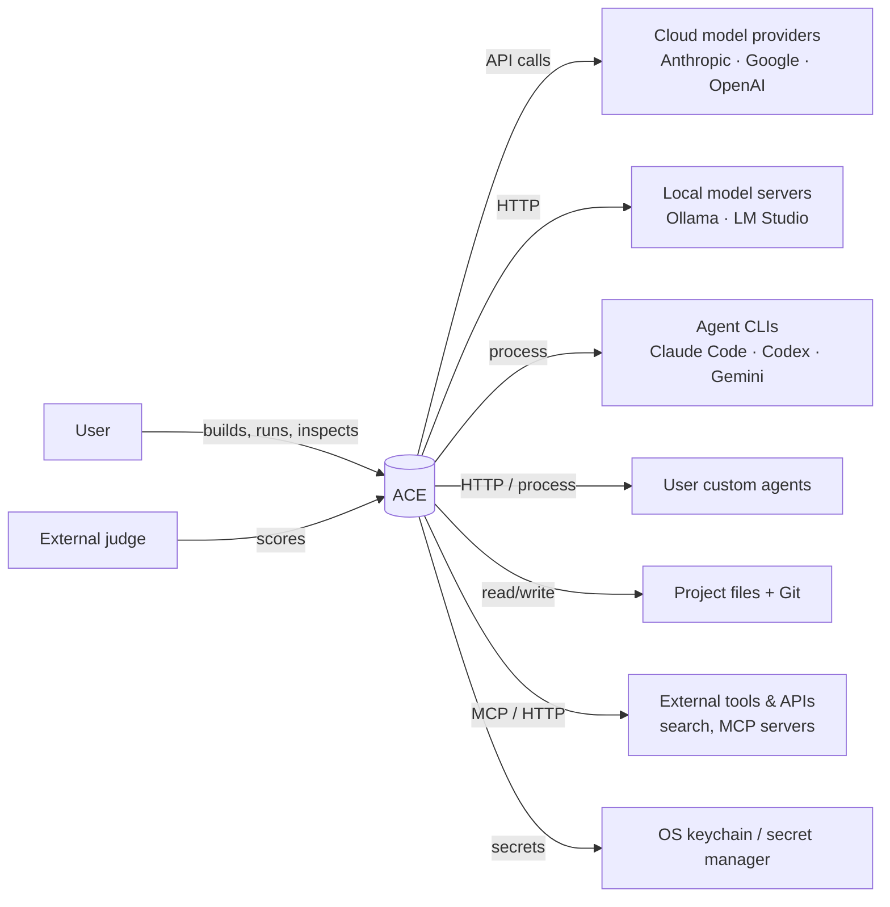

**Trust boundaries:** user device ↔ engine (token + origin) · engine ↔ providers (TLS, keys) · engine ↔ custom nodes and tools (sandbox, permissions) · engine ↔ retrieved/generated content (treated as untrusted).

---

## 7. Deployment Modes

| | **Mode A — Local** (v1) | **Mode B — Hosted** (post-v1) |
|---|---|---|
| Stage 1 | Browser UI + local Node engine | — |
| Stage 2 | Electron desktop app | — |
| Engine location | User's machine | Cloud workers |
| Users | Single | Multi-user, teams |
| Models | User keys, local models, CLIs | User keys, managed keys, hosted open models |
| Storage | SQLite, local files, OS keychain | Postgres, Redis, S3, secret manager |
| Pros | Privacy, local access, zero infra cost | Anywhere access, sharing, billing |

The same engine package runs in both modes by swapping adapter implementations (P7):

| Port (interface) | Local adapter | Hosted adapter |
|---|---|---|
| `Repository` | SQLite (Drizzle) | Postgres (Drizzle) |
| `VectorIndex` | sqlite-vec | pgvector / Qdrant |
| `KeywordIndex` | FTS5 | Postgres FTS |
| `Queue` | In-process queue | BullMQ |
| `PubSub` | In-process emitter | Redis pub/sub |
| `BlobStore` | Local folder | S3-compatible |
| `SecretStore` | Keychain / safeStorage | Secret manager / KMS |
| `Sandbox` | Child process / Docker | Container / microVM |
| `Auth` | Session token | Accounts + API keys |

---

## 8. Layered Architecture

```
┌───────────────────────────────────────────────────────────────────────┐
│ 1. CLIENT        Web app (Vite SPA) · Desktop (Electron) · Mobile ·   │
│                  CLI · TS SDK · Public site (Next.js, hosted)         │
└───────────────────────────────┬───────────────────────────────────────┘
                                │ REST /api/v1 · WebSocket /ws
┌───────────────────────────────▼───────────────────────────────────────┐
│ 2. API GATEWAY   Auth · Origin · Rate limiting · Validation ·         │
│                  Usage metering · Budgets   (Hono · Caddy/Nginx)      │
└───────────────────────────────┬───────────────────────────────────────┘
┌───────────────────────────────▼───────────────────────────────────────┐
│ 3. ORCHESTRATION  Graph · Scheduler · Envelopes · State machines ·    │
│                   Prompt mgmt · RAG · Agents · Tool calling · Memory ·│
│                   Skills · Custom nodes · Events · Chat · Bench       │
│   ╔═══════════════════════════════════════════════════════════════╗   │
│   ║ GUARDRAILS: input · context · tool · output · cost · loop ·   ║   │
│   ║ data  +  Guardrail node                                       ║   │
│   ╚═══════════════════════════════════════════════════════════════╝   │
└──────┬───────────────────────────┬────────────────────────────┬───────┘
┌──────▼──────────────┐ ┌──────────▼───────────────┐ ┌──────────▼───────┐
│ 4. MODEL SERVING    │ │ 5. DATA                  │ │ 6. TOOLS         │
│ Adapters · Router · │ │ SQLite/Postgres ·        │ │ Code sandbox ·   │
│ Catalog · Ollama ·  │ │ sqlite-vec/pgvector ·    │ │ Web search ·     │
│ vLLM/TGI · CLIs     │ │ Redis · Object storage · │ │ File parsers ·   │
│                     │ │ Git · Secrets            │ │ HTTP · MCP       │
└──────┬──────────────┘ └──────────────────────────┘ └──────────────────┘
┌──────▼────────────────────────────────────────────────────────────────┐
│ 7. TRAINING (optional)  Dataset pipeline · LoRA/QLoRA · Eval · Registry│
└───────────────────────────────────────────────────────────────────────┘
┌───────────────────────────────────────────────────────────────────────┐
│ 8. INFRA + OPS   Electron/Node · Docker · Kubernetes · BullMQ ·       │
│                  GPUs · Langfuse · OpenTelemetry · Prometheus · Sentry│
└───────────────────────────────────────────────────────────────────────┘
```

---

## 9. Container View

### 9.1 Local (Mode A)

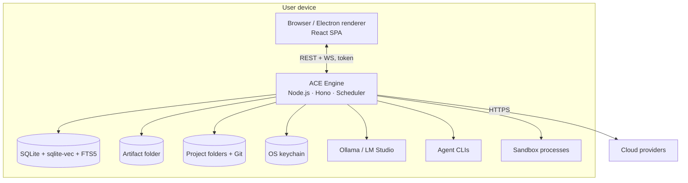

### 9.2 Hosted (Mode B)

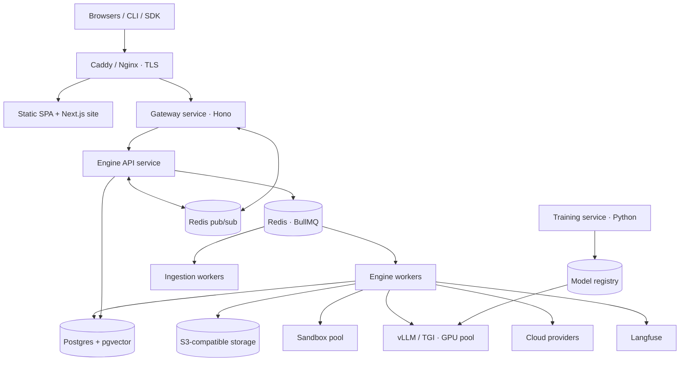

---

## 10. Layer 1 — Client

### 10.1 Web app
- **Tech:** React + Vite, React Flow, Tailwind + shadcn/ui, Zustand, TanStack Query, Monaco, react-resizable-panels, cmdk.
- **Modules:** `canvas`, `nodes`, `config-panel`, `inspector`, `chat`, `runs`, `knowledge`, `library` (skills, custom nodes, templates), `providers`, `guardrails`, `bench`, `settings`, `onboarding`, `account` (hosted).
- **State:** TanStack Query for engine data · Zustand for selection, panels, viewport, live run overlay · a single WebSocket client that patches both.
- **Graph edits:** optimistic, sent as batched operations with a version number; conflicts refetch and reapply.
- **Design system:** dark dotted Canvas, provider accent colors, status rings, serif for human text, monospace for machine text.

### 10.2 Desktop
Electron shell loads the same SPA; main process starts the engine and hands the token to the renderer through a preload script; adds native file dialogs, drag-in, tray, deep links, auto-update.

### 10.3 Mobile
- **v1.x:** responsive web views for run monitoring, outputs, approvals (guardrail "ask user") and chat.
- **Later:** React Native app sharing the SDK. Building workflows stays desktop/web.

### 10.4 CLI
| Command | Purpose |
|---|---|
| `ace login` / `ace connect <url>` | Connect to local engine or hosted account |
| `ace run <workflow> --input file` | Run and stream results |
| `ace runs list` / `ace runs show <id>` | History and detail |
| `ace export <workflow>` / `ace import <file>` | Workflow files |
| `ace bench run <experiment>` | Run a benchmark from CI |

### 10.5 SDK
TypeScript client generated from the shared contracts (OpenAPI generated from Zod). Typed methods for every endpoint plus an event stream helper. Python SDK later if demand exists.

---

## 11. Layer 2 — API Gateway

| Concern | Mode A | Mode B |
|---|---|---|
| Entry | Engine on `127.0.0.1` | Caddy/Nginx (TLS) → gateway |
| Authentication | Random session token; origin allow-list | Accounts (Better Auth / Auth.js), OAuth, sessions, scoped API keys |
| Authorization | Single user | Workspace roles: owner, editor, viewer; resource ownership checks |
| Rate limiting | Per-provider concurrency + backoff | Redis token bucket per user, key, workspace, route |
| Validation | Zod middleware | Same |
| Usage metering | Tokens/cost per node run | Aggregated per workspace/day → plans and Stripe billing |
| Budgets | Per-run cost cap | Per-run, per-day, per-plan caps |
| Idempotency | — | `Idempotency-Key` header on run creation |
| WebSocket | Direct | Sticky sessions or pub/sub fan-out |
| Request tracing | Request ID | Request ID + OpenTelemetry trace ID |

---

## 12. Layer 3 — Orchestration

### 12.1 Component view

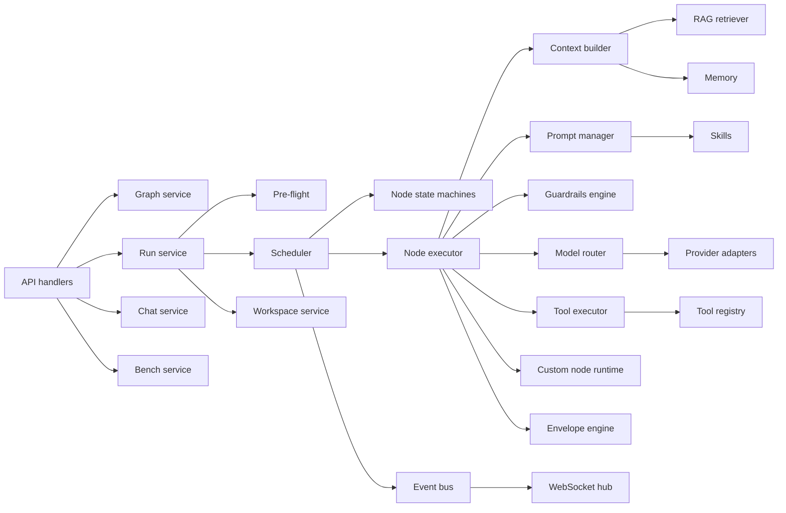

### 12.2 Subsystems

| Subsystem | Responsibility | Phase |
|---|---|---|
| Graph service | CRUD, batch ops, validation, versions, layout | 2–3 |
| Run service | Start/pause/resume/stop/restart/replay | 5–6 |
| Pre-flight | Providers, models, capabilities, guardrails, budgets | 5 |
| Scheduler | Dependency order, parallelism, loops | 5–7 |
| Node executor | Runs one node end to end | 5 |
| Envelope engine | Build and validate envelopes | 5 |
| Prompt manager | Assembly, templates, versions | 5, 11 |
| Context builder | Budgeted context from summaries, RAG, memory | 10 |
| Guardrails engine | Policies at 7 points | 6, 15 |
| Model router | Picks model per policy | 4 |
| Tool executor | Permission-checked tool calls | 11 |
| Custom-node runtime | HTTP and script nodes | 11 |
| Event bus | Ordered events, fan-out, replay | 2, 5 |
| Chat service | Timeline, direct agent threads | 9 |
| Workspace service | Git, files, replay | 12 |
| Bench service | Tasks, experiments, blind export, reports | 13 |

### 12.3 Scheduler algorithm

```
start(run):
  snapshot = freeze(workflow)
  issues = preflight(snapshot)            → if any: run BLOCKED, stop
  mark nodes with all required inputs available as READY

loop:
  if paused: wait for resume
  for node in READY (respecting provider + global concurrency):
      dispatch(node)                      → RUNNING
  on node success:
      save node run, emit output
      for edge in outgoing(node):
         data edge → deliver envelope; target READY when required inputs complete
         loop edge → if exit not met and iteration < max: requeue target (iteration+1)
                     else follow exit path per config
  on node failure:
      apply retry policy → else FAILED (or CONTRACT_VIOLATION / GUARDRAIL_VIOLATION)
      mark unreachable downstream BLOCKED
  on user approval required:
      node WAITING until approve/reject
  when nothing RUNNING, READY or WAITING:
      all output nodes completed → COMPLETE else HALTED
```

### 12.4 Envelope

```ts
Envelope = {
  id, runId, fromNodeId, toNodeId, iteration,
  reads: Part[],                        // text | image | audio | video | code | file | json
  context: {
    summary?, retrieved?: {chunkId, text, score, source}[],
    memory?: {key, value}[], budgetTokens,
    trust: 'trusted' | 'untrusted'       // guardrail tagging
  },
  contract: { outputTypes, jsonSchema?, maxTokens? },
  guardrailVerdicts?: Verdict[],
  createdAt
}
```

### 12.5 Prompt management
- **Assembly order:** system base → agent instructions → skills (fixed order) → guardrail instructions → context (summary, retrieved, memory, clearly delimited and labelled untrusted) → reads → output contract.
- **Templates:** `{{input.text}}`, `{{memory.key}}`, `{{run.iteration}}`.
- **Versions:** agent prompts and skills are versioned; node runs record versions.
- **Library:** project-level saved prompts.
- **Tracing:** prompt versions and outputs sent to Langfuse (optional locally, default hosted).

### 12.6 RAG pipeline

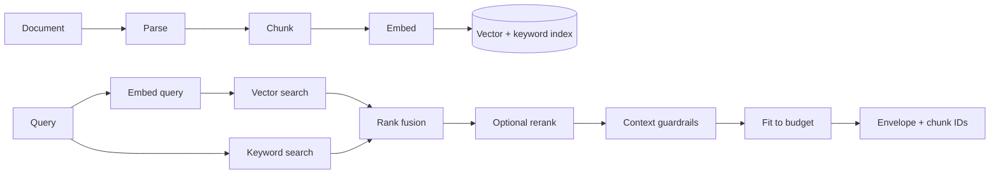

- Chunking: by headings/paragraphs, code by function; ~500–800 tokens, 10–15% overlap.
- Embeddings: local (Ollama) or cloud; model recorded per knowledge base.
- Use: attach KB to an agent (implicit) or Retrieval node (explicit).
- Quality: hit-rate@k measured on a labelled set.

### 12.7 Agents and tool calling

```
agent node = model + instructions + skills + tools + context policy + memory + guardrail policy + routing policy

tool loop (inside one node):
  model → tool request → tool guardrail (allow / ask user / block)
        → tool executor → tool result → context guardrail → model
  repeat until final answer or max tool calls reached
```

### 12.8 Memory

| Type | Scope | Storage | Lifetime |
|---|---|---|---|
| Short-term | One handoff | Envelope context | One run |
| Long-term | One agent (or workflow) | `agent_memory` | Until user clears |
| Knowledge | Project | Knowledge bases | Until removed |
| Cache | System | Summary/embedding cache | TTL / LRU |

---

## 13. Guardrails

### 13.1 Guardrail points

| Point | Checks | Default action |
|---|---|---|
| Input | Size/type limits, PII, prompt-injection patterns, blocked topics | Warn / block |
| Context | Untrusted tagging, hidden-instruction stripping, PII redaction | Tag + sanitize |
| Tool | Allowed tool, valid arguments, path inside project, domain allow-list, destructive action | Block / ask user |
| Output | Output contract, moderation, secret-leak detection, PII, required citations | Block / redact / retry once |
| Cost | Max tokens per node, max cost per run, daily budget | Stop run (HALTED) |
| Loop | Max iterations, max tool calls, repeated-output detection | Stop loop |
| Data | No secrets in DB/logs/exports; file confinement | Always on |

### 13.2 Implementation

| Check | Local (free options) | Hosted (additional) |
|---|---|---|
| Contract | Zod | Same |
| Prompt injection | Rule pack + small classifier via Ollama | Hosted classifier |
| Moderation | Llama Guard via Ollama | Llama Guard on vLLM or provider moderation endpoints |
| PII | Regex rule pack | Presidio service |
| Secret leaks | Key-format patterns | Same |
| Permissions | Declared per agent / custom node | + workspace policies |
| Budgets | Per run | Per run / user / plan |

### 13.3 Outcomes
**Pass** → continue · **Warn** → continue + warning event · **Redact** → continue with sanitized data (records type removed, never the value) · **Ask user** → node `WAITING` · **Block** → `GUARDRAIL_VIOLATION` (D9).

### 13.4 Policies and Guardrail node
- Policies: project default → agent override. Stored as versioned JSON; run records the policy version.
- Guardrail node: placed between nodes; outputs sanitized data + verdict; edges can branch on verdict (pass / block).

---

## 14. Layer 4 — Model Serving

### 14.1 Providers

| Provider type | Local | Hosted |
|---|---|---|
| Anthropic, Google, OpenAI | ✅ user keys | ✅ user or managed keys |
| OpenAI-compatible (Ollama, LM Studio, custom) | ✅ | ✅ custom endpoints |
| Self-hosted open models (vLLM / TGI) | — | ✅ optional GPU pool |
| CLIs (Claude Code, Codex, Gemini) | ✅ | — |
| Embeddings | Ollama or cloud | Same or self-hosted |
| Mock | ✅ dev/test | ✅ tests |

### 14.2 Adapter contract
```ts
interface ProviderAdapter {
  type: ProviderType
  check(): Promise<ProviderStatus>
  listModels(): Promise<ModelInfo[]>
  generate(req: GenerateRequest, signal: AbortSignal): AsyncIterable<StreamChunk>
  embed?(texts: string[]): Promise<number[][]>
}
```
Built on the Vercel AI SDK where possible; errors mapped to ACE error kinds; concurrency limits and backoff per provider.

### 14.3 Model router

| Policy | Behaviour | Version |
|---|---|---|
| Fixed | Always the chosen model | v1 |
| Fallback chain | A → B → C on provider/network failure | v1 |
| Capability | First available model supporting required data types | v1.x |
| Cost-aware | Cheapest capable model | v1.x |
| Latency-aware | Fastest capable model by recent measurements | v1.x |

The model actually used is always recorded and shown. Bench runs force **Fixed**.

### 14.4 Model catalog
Discovery where supported, versioned manifest otherwise. Fields: provider, model ID, display name, input/output types, context window, tool support, JSON mode, availability, last checked.

---

## 15. Layer 5 — Data

### 15.1 Stores

| Store | Holds | Local | Hosted |
|---|---|---|---|
| Relational | All entities | SQLite + Drizzle | Postgres + Drizzle |
| Vector | Chunk embeddings | sqlite-vec | pgvector (Qdrant at scale) |
| Keyword | Chunk text | FTS5 | Postgres FTS |
| Cache | Summaries, catalog, embeddings | LRU + SQLite | Redis |
| Queue | Node jobs, ingestion jobs | In-process | BullMQ |
| Pub/sub | Live events | In-process | Redis |
| Objects | Artifacts | Local folder | S3-compatible |
| Workspaces | Project files + Git | Local folders | Volumes / git remotes |
| Secrets | Provider keys | Keychain → safeStorage | Secret manager / KMS |
| Traces | LLM traces | Event log (+ optional Langfuse) | Langfuse |

### 15.2 Entity relationships

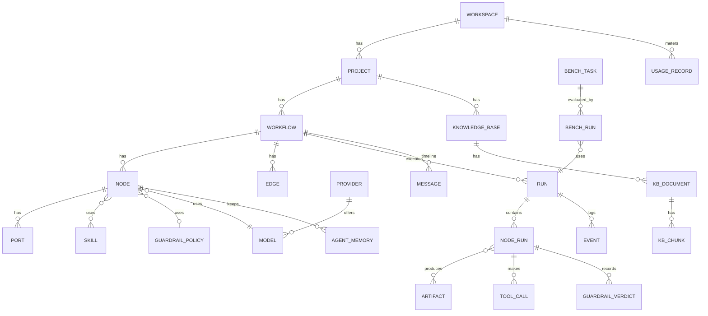

`WORKSPACE`, `USAGE_RECORD` and user/team tables exist only in hosted mode; local mode uses one implicit workspace.

### 15.3 Tables
projects · workflows · nodes · ports · edges · providers · models · skills · node_skills · guardrail_policies · custom_node_defs · runs · node_runs · tool_calls · guardrail_verdicts · artifacts · messages · chat_threads · events · knowledge_bases · kb_documents · kb_chunks · kb_vectors · agent_memory · prompt_library · bench_tasks · bench_experiments · bench_runs · settings · *(hosted)* users · workspaces · memberships · api_keys · usage_records · subscriptions · audit_log.

Full column list: Build Blueprint §4.

### 15.4 Retention

| Data | Default retention |
|---|---|
| Workflows, projects | Until deleted |
| Runs, node runs, events | Local: until deleted · Hosted: by plan (e.g. 30/90/365 days) |
| Artifacts | Until unreferenced + 7 days |
| Chat threads | Until deleted |
| Logs | Local: 14 days rotated · Hosted: 30 days |
| Bench data | Permanent (frozen) |

---

## 16. Layer 6 — Tools

| Tool | Local | Hosted | Phase |
|---|---|---|---|
| File parsers (PDF, DOCX, HTML, MD, code, CSV/JSON) | unpdf, mammoth, readability | Ingestion workers | 10 |
| Media (resize, transcription, frames) | sharp; optional local Whisper server | Media workers | 8 |
| Code sandbox | Child process with limits; Docker when available | Containers with gVisor / Firecracker | 11 |
| Web search / fetch | SearXNG (self-hosted) or user-keyed API | Same | 11 |
| HTTP request | Domain allow-list | Same | 11 |
| MCP client | Connect MCP servers' tools to agents | Same | 11 |
| File system | Confined to project | Confined to workspace | 12 |
| Git | simple-git | Same | 12 |
| Custom nodes | HTTP + script | HTTP; scripts in sandbox | 11 |

**Tool definition:** name · description · input schema · output schema · permissions (`network`, `fsPaths`, `destructive`) · timeout. Every call passes tool guardrails and is logged in `tool_calls`.

---

## 17. Layer 7 — Training / Fine-Tuning (optional, post-v1)

```mermaid
flowchart LR
    BR[Graded bench runs + approved outputs] --> CON{User consent?}
    CON -- yes --> PII[PII removal] --> DS[Dataset builder]
    DS --> FT[LoRA / QLoRA training]
    FT --> EV[Eval on ACE Bench<br/>(non-frozen split only)]
    EV -->|beats baseline| REG[(Model registry)]
    REG --> SRV[vLLM (hosted) / GGUF export for Ollama (local)]
```

| Component | Detail |
|---|---|
| Targets | Small open models for reviewer/judge, router, guardrail classifier roles |
| Stack | Python, Hugging Face Transformers + PEFT or Unsloth |
| Registry | Model version, base model, dataset hash, metrics, approval status |
| Guard | Frozen benchmark tasks never used for training |

---

## 18. Layer 8 — Infra and Ops

### 18.1 Local

| Area | Choice |
|---|---|
| Runtime | Node engine via `pnpm dev`; Electron in desktop |
| Packaging | electron-builder (NSIS, dmg + notarization, AppImage/deb) |
| Updates | electron-updater + GitHub Releases |
| CI/CD | GitHub Actions |

### 18.2 Hosted

| Area | Choice |
|---|---|
| Containers | Docker images: web, gateway, api, workers, ingestion, sandbox, training |
| Orchestration | Managed containers first → Kubernetes when needed (HPA on queue depth) |
| Queue | BullMQ on Redis; Kafka only at very high event volume |
| GPUs | vLLM/TGI node pool with autoscaling (only if hosting models) |
| Database | Managed Postgres + pgvector, PITR |
| Storage | S3-compatible with lifecycle rules |
| IaC | Terraform |
| Secrets | Cloud secret manager |

### 18.3 Environments

| Env | Purpose | Data |
|---|---|---|
| Local dev | Development | Mock provider + test keys |
| CI | Automated tests | Temp DB, mock provider |
| Staging (hosted) | Pre-release checks | Synthetic data |
| Production | Users | Real data |

### 18.4 CI/CD pipeline
```
PR → lint → typecheck → unit → integration → component → E2E (mock) → build
main → nightly provider contract tests
tag → build installers / images → sign → release → (hosted) deploy staging → smoke → deploy prod
```

---

## 19. State Machines

### 19.1 Node

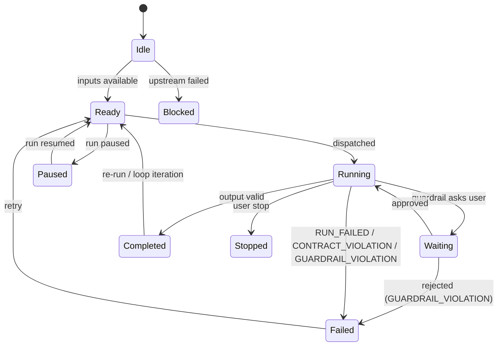

### 19.2 Run

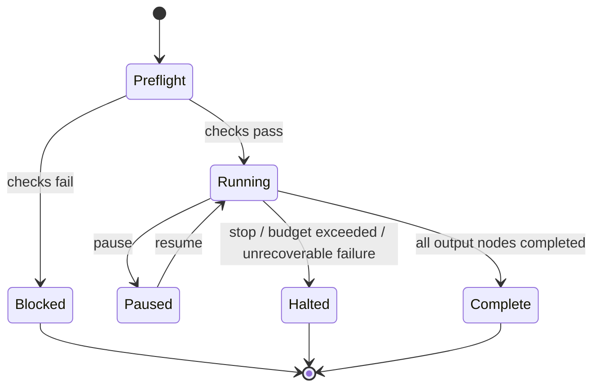

### 19.3 Provider
`Unknown → Checking → Connected | AuthFailed | Unreachable | RateLimited` (rechecked on schedule and before each run).

---

## 20. API Architecture

### 20.1 Conventions
- Base `/api/v1`; JSON; Zod-validated; OpenAPI generated from schemas.
- Errors: `{ error: { kind, code, message, details?, retryable } }`.
- Concurrency: `If-Match: <version>` on graph writes → `409` on conflict.
- Pagination: cursor-based (`?cursor=&limit=`).
- Idempotency (hosted): `Idempotency-Key` on run creation.
- Auth: bearer session token (local) / session or API key (hosted).

### 20.2 Endpoint groups

| Group | Examples |
|---|---|
| System | `GET /health`, `GET/PATCH /settings` |
| Projects | `GET/POST /projects`, `GET/PATCH/DELETE /projects/:id` |
| Workflows | `GET/POST /projects/:id/workflows`, `GET/PATCH/DELETE /workflows/:id`, `POST /workflows/:id/graph-ops`, `/validate`, `/layout`, `/duplicate`, `/export` |
| Nodes & edges | `POST /workflows/:id/nodes`, `PATCH/DELETE /nodes/:id`, `POST /workflows/:id/edges`, `PATCH/DELETE /edges/:id` |
| Providers & models | `GET/POST /providers`, `POST /providers/:id/check`, `/refresh-models`, `GET /models` |
| Runs | `POST /workflows/:id/runs`, `GET /runs/:id`, `POST /runs/:id/pause|resume|stop|restart|replay`, `GET /runs/:id/events` |
| Node runs | `GET /node-runs/:id`, `POST /node-runs/:id/retry`, `POST /runs/:id/nodes/:nodeId/rerun` |
| Approvals | `POST /node-runs/:id/approve`, `POST /node-runs/:id/reject` |
| Artifacts & files | `POST /artifacts`, `GET /artifacts/:id/content`, `GET/PUT /projects/:id/files/content`, `GET /projects/:id/git/log|diff` |
| Chat | `GET/POST /workflows/:id/messages`, `POST /nodes/:id/chat`, `GET /chat/threads/:id` |
| Knowledge & memory | `POST /projects/:id/knowledge-bases`, `POST /knowledge-bases/:id/documents`, `POST /knowledge-bases/:id/query`, `GET/DELETE /nodes/:id/memory` |
| Guardrails | `GET/POST /guardrail-policies`, `PATCH/DELETE /guardrail-policies/:id`, `POST /guardrail-policies/:id/test` |
| Tools | `GET /tools`, `POST /mcp-servers`, `DELETE /mcp-servers/:id` |
| Skills & custom nodes | `GET/POST /skills`, `POST /nodes/:id/skills`, `GET/POST /custom-nodes`, `POST /custom-nodes/:id/test` |
| Bench | `POST /bench/tasks`, `/freeze`, `POST /bench/experiments`, `/start`, `/blind-export`, `/scores`, `/report` |
| Hosted only | `/auth/*`, `/workspaces`, `/members`, `/api-keys`, `/usage`, `/billing` |

### 20.3 WebSocket
- Client → server: `subscribe`, `unsubscribe`, `resume { afterSeq }`.
- Server → client: `workflow.updated`, `run.started|paused|resumed|completed`, `node.state`, `node.token`, `node.output`, `node.error`, `node.approval_required`, `edge.transfer`, `loop.iteration`, `tool.call`, `guardrail.verdict`, `message.created`, `provider.status`, `kb.ingest`, `usage.updated`.

---

## 21. Key Flows

### 21.1 Run a workflow

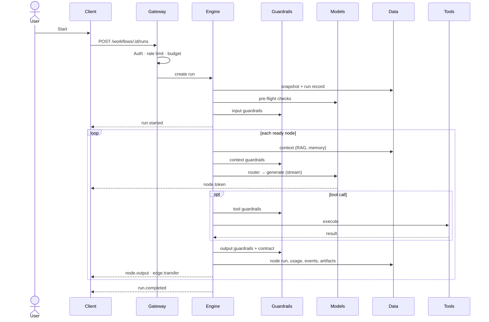

### 21.2 Guardrail approval

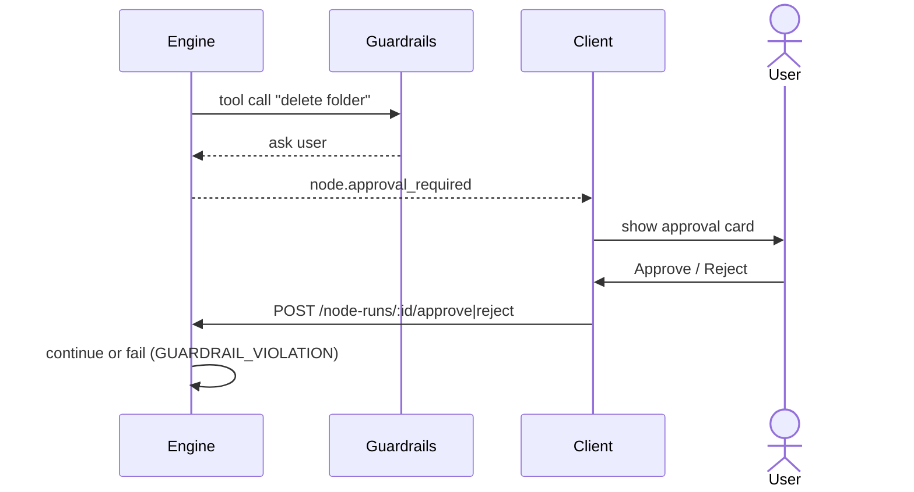

### 21.3 Knowledge ingestion

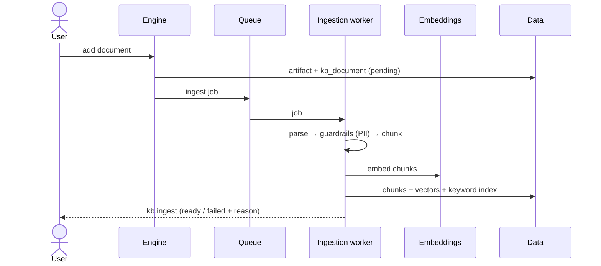

### 21.4 Reconnect
Client reconnects → `resume { afterSeq }` → engine replays missed events from `events` → client state consistent.

---

## 22. Security Architecture

### 22.1 Controls

| Area | Control |
|---|---|
| Network | Local: bind 127.0.0.1, token, origin allow-list · Hosted: TLS, WAF, private subnets |
| Identity | Hosted: accounts, OAuth, MFA option, scoped API keys |
| Secrets | Keychain / safeStorage / secret manager; never in DB, logs, exports |
| Data in transit | TLS to providers and hosted services |
| Data at rest | Hosted: encrypted DB and storage; local: OS disk encryption recommended |
| Isolation | Sandboxed scripts and code; file confinement; per-workspace data separation |
| Content safety | Guardrails; untrusted-content tagging |
| Supply chain | Lockfiles, dependency audit, signed installers, container scanning |
| Audit | Hosted: audit log of logins, key changes, policy changes, deletions |

### 22.2 Threat model (STRIDE)

| Threat | Example | Mitigation |
|---|---|---|
| Spoofing | Malicious website calls local engine | Token + origin allow-list |
| Tampering | Edited run history | Append-only events, immutable snapshots |
| Repudiation | "I didn't approve that tool call" | Approval events with timestamp and user |
| Information disclosure | API key in logs or exports | Redaction, secret storage, export filter |
| Denial of service | Infinite loop burns budget | Loop limits, budgets, rate limits |
| Elevation of privilege | Prompt injection makes agent delete files | Tool permissions, confirmations, sandbox, path confinement |

---

## 23. Multi-Tenancy (Hosted)

- **Model:** shared database with `workspace_id` on every tenant-owned row; enforced in the repository layer and by Postgres row-level security.
- **Storage:** object keys prefixed by workspace.
- **Isolation:** sandboxes and worker jobs carry workspace identity; no cross-workspace cache keys.
- **Limits:** per-workspace quotas for runs, storage, concurrency.
- **Enterprise option (later):** dedicated database or deployment.

---

## 24. Scalability and Performance

| Area | Approach |
|---|---|
| Canvas | Virtualized rendering, memoized nodes, batched updates, throttled streaming paints |
| Graph edits | Batched operations, single transaction |
| Execution | Global + per-provider concurrency; hosted workers scale on queue depth |
| Streaming | Token batching (~50 ms) before sending to clients |
| RAG | Precomputed embeddings, cached query embeddings, top-k limits |
| Database | Indexes on foreign keys, run status, created time; event table partitioned by month (hosted) |
| Artifacts | Content addressing avoids duplicates; range requests for media |
| Models | Router picks cheaper/faster models where allowed; prompt caching where providers support it |

---

## 25. Reliability and Disaster Recovery

| Scenario | Handling |
|---|---|
| Engine crash | Restart marks in-flight runs HALTED (reason recorded); nothing half-written |
| Client disconnect | Resume from last event sequence |
| Provider outage | Pre-flight blocks; fallback routing if configured; retries with backoff |
| Worker crash (hosted) | Queue redelivers job; node runs are idempotent by attempt ID |
| DB migration failure | Automatic backup before migration; rollback script |
| Data loss (hosted) | Daily backups + point-in-time recovery; RPO ≤ 15 min, RTO ≤ 4 h |
| Local data | Export/backup command; data folder easy to copy |

---

## 26. Observability

| Signal | Local | Hosted |
|---|---|---|
| Logs | pino JSON, rotated, secrets redacted | Central log store |
| Run traces | Event log + trace view in UI | Same + OpenTelemetry |
| LLM traces | Optional local Langfuse | Langfuse (prompts, costs, evals) |
| Metrics | Basic counters in settings screen | Prometheus + Grafana |
| Errors | Optional Sentry (opt-in) | Sentry |

**Key metrics:** runs started/completed/halted · node failures by kind · guardrail verdicts by type · provider latency and error rate · tokens and cost per workspace · queue depth and wait time · stream latency · ingestion duration.

**Hosted SLOs:** API availability 99.5% · p95 run-start latency < 1 s · p95 stream latency < 300 ms.

**Alerts:** provider error rate spike · queue backlog · budget exhaustion · failed backups · elevated guardrail blocks.

---

## 27. Cost Architecture

| Lever | Mechanism |
|---|---|
| Bounded context | Envelopes carry only what's needed |
| Caching | Summaries and embeddings cached by content hash; provider prompt caching |
| Routing | Cheaper capable models where policy allows |
| Budgets | Per node, run, day, plan |
| Batch APIs | For bench runs where latency doesn't matter |
| Local models | Zero-cost option via Ollama |
| Metering | Tokens and estimated cost on every node run; totals per run and workspace |

Pricing tables live in the model catalog manifest and are versioned, so cost estimates are reproducible.

---

## 28. Error Handling Model

| Error kind | Example | Retry | Resulting state |
|---|---|---|---|
| user_cancelled | Stop pressed | No | Stopped |
| agent | Model refused / bad output | Once (contract repair) | CONTRACT_VIOLATION / Failed |
| provider | 5xx, 429 | Yes, backoff | Failed after retries |
| auth | 401/403 | No | Failed; provider marked AuthFailed |
| network | Timeout, DNS | Yes, backoff | Failed after retries |
| invalid_config | Missing model | No | BLOCKED at pre-flight |
| workflow | Upstream failed | No | BLOCKED |
| guardrail | Policy block / rejected approval | No | GUARDRAIL_VIOLATION |

Every error carries `kind`, `code`, `message`, `retryable`, provider info, and the node run ID.

---

## 29. Configuration and Environments

| Layer | Source | Examples |
|---|---|---|
| Defaults | Code | Timeouts, limits |
| Engine config | `ace.config.json` / env vars | Port, data folder, log level |
| User settings | `settings` table | Default provider, budgets, theme |
| Project settings | Project record | Guardrail policy, KB defaults |
| Node config | Node record | Model, prompts, tools |
| Hosted | Env vars + secret manager | DB URL, Redis URL, OAuth keys |

Precedence: node → project → user → engine → defaults. All config validated by Zod at startup.

---

## 30. Code Organization

```
ace/
├─ apps/
│  ├─ web/              React SPA
│  ├─ desktop/          Electron shell
│  ├─ site/             Next.js public site (hosted)
│  ├─ cli/              ace CLI
│  └─ server/           Hosted gateway + API entry
├─ packages/
│  ├─ contracts/        Zod schemas, OpenAPI generation
│  ├─ engine/           orchestration core (ports & adapters)
│  ├─ providers/        model adapters + router + catalog
│  ├─ guardrails/       policies, rule packs, classifiers
│  ├─ context/          parsing, chunking, embeddings, retrieval
│  ├─ tools/            tool registry, sandbox, search, MCP client
│  ├─ storage-local/    SQLite, sqlite-vec, FTS5, keychain, fs blobs
│  ├─ storage-cloud/    Postgres, pgvector, Redis, S3, secret manager
│  ├─ sdk/              TypeScript SDK
│  ├─ ui/               shared components + design tokens
│  └─ config/           tsconfig, eslint, prettier
├─ services/
│  └─ training/         Python fine-tuning service (post-v1)
├─ bench/               frozen tasks and rubrics
├─ infra/               Dockerfiles, Terraform, k8s manifests
└─ docs/                ARCHITECTURE.md, FRS, DECISIONS.md, API reference
```

**Dependency rules:** `engine` depends on `contracts` and interfaces only · `storage-*` implement engine ports · `web` never imports Node modules · `engine` never imports browser APIs.

---

## 31. Testing Architecture

| Level | Target | Tooling |
|---|---|---|
| Unit | Contracts, scheduler, envelopes, guardrail rules, router, chunking | Vitest |
| Integration | Engine API with temp DB + mock provider | Vitest |
| Component | React components | Vitest + Testing Library |
| E2E | Full journeys in browser and Electron | Playwright |
| Provider contract | Real provider calls | Nightly, tagged |
| Guardrail suite | Injection, PII, leaks, tool abuse corpora | Vitest |
| Performance | Large graphs, parallel load, streaming | Playwright traces, scripts |
| Security | Auth, origin, traversal, sandbox escapes | Automated + manual review |
| Recovery | Crash, disconnect, outage | Fault injection |
| UAT | Real tasks | Checklist (FRS §8.7) |

Test cases and exit criteria: FRS §8.

---

## 32. Versioning and Migration

| Item | Strategy |
|---|---|
| API | `/api/v1`; additive changes only within v1; breaking → v2 with overlap period |
| Contracts | Semver in `packages/contracts` |
| Database | Drizzle migrations, forward-only, backup before apply |
| Workflow file format | `formatVersion` field; importer upgrades old versions |
| Prompts, skills, policies | Versioned records; runs store versions |
| Desktop | Semantic versions; auto-update; engine and UI shipped together |
| Local → hosted | Export/import workflows, KBs, skills (secrets excluded) |

---

## 33. User Flow

### 33.1 Journey
1. **Arrive.**
   - *Local:* open ACE and the app starts directly.
   - *Hosted:* sign up or log in.
2. **Setup (first time).** Add a provider (API key or one-click Ollama). ACE tests it and lists models.
3. **Start.** Pick a template (Linear chain, Review→Fix, Parallel research, RAG Q&A) or blank. A project is created.
4. **Projects.** See projects and recent runs, then open one.
5. **Canvas.**
   - **Left:** palette.
   - **Center:** workflow.
   - **Right:** node settings.
   - **Bottom:** timeline, events, errors, code.
6. **Build.**
   - Drag nodes, then set each one's model, instructions, data types, tools, skills, guardrails.
   - Draw arrows to connect them. Invalid connections are refused with a reason.
7. **Add knowledge (optional).** Create a knowledge base, upload documents, test search, then attach it to an agent or add a Retrieval node.
8. **Run.**
   - Press Start and provide input.
   - Watch node states, streaming text and arrows lighting up as data moves.
9. **Inspect and control.**
   - Click nodes for inputs, outputs, sources, tokens, cost and guardrail results.
   - Pause, resume, stop or restart the run.
10. **Fix.**
    - Read the error, fix the settings, press Retry. No rebuild needed.
    - Approve or reject guardrail requests in place.
11. **Chat.** Talk to any agent from its Chat tab without changing the run.
12. **Extend.** Add skills, custom nodes, MCP tools, and more providers.
13. **History.** View files and diffs, browse runs, replay any past run.
14. **Measure.** Use Bench to freeze tasks, compare setups, export for blind judging, and read the report.
15. **Manage.**
    - Settings, budgets and guardrail policies.
    - *Hosted only:* team, API keys, usage and billing.

### 33.2 Site map

```
ACE
├── (Hosted) Website: Home · Features · Pricing · Docs · Login / Sign up
├── Onboarding: Add provider → Choose template
├── Projects
│   └── Project
│       ├── Workflows (tabs) → Canvas
│       │   ├── Node settings · Chat · Inspector · Approvals
│       │   └── Timeline · Events · Errors · Code
│       ├── Runs → Run detail → Replay
│       ├── Knowledge bases → Documents · Test search
│       └── Files (git history, diffs)
├── Library: Skills · Custom nodes · Tools (MCP) · Templates · Prompts
├── Providers & Models
├── Guardrail policies
├── Bench: Tasks · Experiments · Reports
├── Settings
└── (Hosted) Account · Team · API keys · Usage & Billing
```

### 33.3 Routes

| Route | Screen |
|---|---|
| `/` | Hosted: marketing · Local: → `/projects` |
| `/login`, `/signup` | Hosted auth |
| `/onboarding` | First-run setup |
| `/projects`, `/projects/:projectId` | Projects |
| `/projects/:projectId/workflows/:workflowId` | Canvas |
| `/projects/:projectId/runs`, `/runs/:runId` | Runs |
| `/projects/:projectId/knowledge`, `/knowledge/:kbId` | Knowledge |
| `/projects/:projectId/files` | Files |
| `/library/skills`, `/library/custom-nodes`, `/library/tools`, `/library/templates`, `/library/prompts` | Library |
| `/providers` | Providers & models |
| `/guardrails` | Policies |
| `/bench`, `/bench/experiments/:id` | Bench |
| `/settings` | Settings |
| `/account`, `/team`, `/api-keys`, `/usage` | Hosted only |

### 33.4 Flow diagram

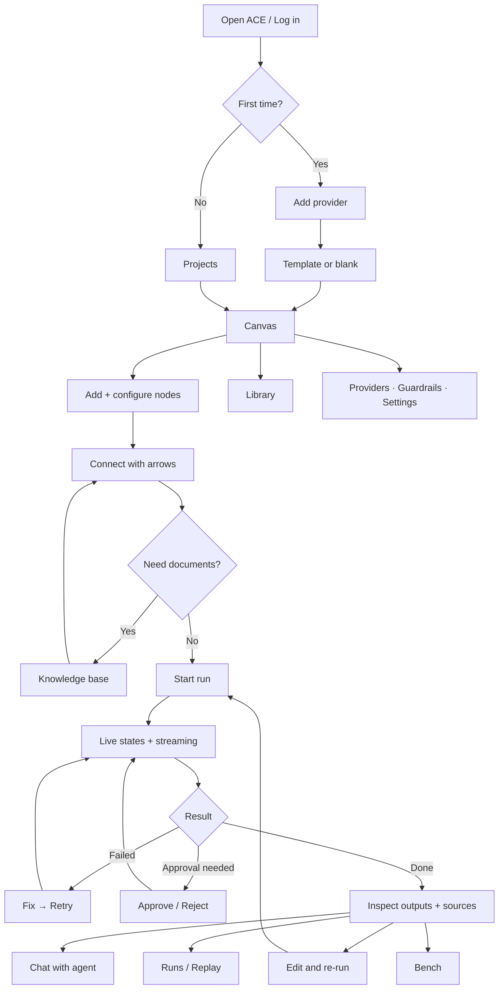

---

## 34. Roadmap: Layers × Phases

| Phase | Name | Layers | Key architecture work |
|---|---|---|---|
| 0 | Foundations | All | ADRs, decisions D1–D15, monorepo |
| 1 | Contracts + DB | 3, 5 | Zod contracts incl. guardrail + tool schemas; local storage adapters |
| 2 | Engine skeleton | 2, 3, 5 | Gateway middleware, event bus, WebSocket hub |
| 3 | Canvas | 1 | SPA shell, React Flow, design system |
| 4 | Providers | 4 | Adapters, catalog, router (fixed + fallback) |
| 5 | Execution engine | 3, 4, 5 | Scheduler, envelopes, state machines, prompt manager |
| 6 | Control + errors + guardrails | 3 | Controls, error model, guardrail engine (input/output/cost/loop), approvals |
| 7 | Parallel + loops | 3 | Merge node, loop edges, loop guardrails |
| 8 | Multimodal | 3, 5, 6 | Artifact store, media tools |
| 9 | Chat + communication | 1, 3 | Timeline, agent threads |
| 10 | Context & RAG | 3, 4, 5, 6 | Parsers, embeddings, hybrid search, memory, context guardrails |
| 11 | Skills, custom nodes, tools | 3, 6 | Tool registry, sandbox, web search, MCP, Guardrail node |
| 12 | Workspace + code | 3, 5, 6 | Git, files, replay |
| 13 | ACE Bench | 3, 5 | Bench service |
| 14 | Testing & QA | All | Full suites incl. guardrail corpus |
| 15 | Hardening | 2, 8 | Security review, Llama Guard, observability |
| 16 | Desktop | 1, 8 | Electron, packaging, updates |
| 17 | Launch | 1, 8 | Onboarding, docs, CLI + SDK v1 |
| 18 | Hosted platform (post-v1) | 1, 2, 5, 8 | Accounts, teams, metering, billing, cloud adapters, Langfuse, Prometheus |
| 19 | Hosted models (post-v1, optional) | 4, 8 | vLLM/TGI GPU pool |
| 20 | Fine-tuning (post-v1, optional) | 7 | Dataset pipeline, LoRA, registry |
| 21 | Mobile app (post-v1, optional) | 1 | React Native monitoring app |

---

## 35. Technology Stack

| Layer | Local (v1) | Hosted (post-v1) |
|---|---|---|
| Client | React, Vite, React Flow, Tailwind, shadcn/ui, Zustand, TanStack Query, Monaco, Electron | Same + Next.js site; React Native later |
| Gateway | Hono middleware | Caddy/Nginx, Hono, Better Auth/Auth.js, Redis rate limits, Stripe |
| Orchestration | TypeScript engine, XState v5, Zod, Vercel AI SDK | Same as workers |
| Guardrails | Zod, rule packs, Llama Guard (Ollama) | + Presidio, hosted classifiers |
| Models | Anthropic, Google, OpenAI, Ollama, LM Studio, CLIs, mock | + vLLM/TGI |
| Data | SQLite, Drizzle, sqlite-vec, FTS5, local files, keychain | Postgres, pgvector, Redis, S3, secret manager |
| Tools | unpdf, mammoth, sharp, simple-git, child-process sandbox, SearXNG, MCP client | + container/microVM sandboxes |
| Training | — | Python, Transformers, PEFT/Unsloth |
| Infra/Ops | GitHub Actions, electron-builder, pino, Sentry (opt-in) | Docker, Kubernetes, Terraform, BullMQ, Langfuse, OpenTelemetry, Prometheus, Grafana, Sentry |
| Testing | Vitest, Testing Library, Playwright | Same |

---

## 36. Architecture Decision Records

| ADR | Decision | Status | Reason |
|---|---|---|---|
| ADR-001 | Web UI + local engine first; Electron later | Accepted | Local access now, cheap desktop migration |
| ADR-002 | Custom orchestration engine instead of LangGraph/LlamaIndex | Accepted | Canvas graph is the execution model; envelopes and states are core |
| ADR-003 | Vite SPA for app; Next.js only for public site | Accepted | App must run inside Electron without a server |
| ADR-004 | TypeScript gateway (Hono) instead of FastAPI | Accepted | One language, shared schemas |
| ADR-005 | SQLite locally, Postgres hosted, via Drizzle | Accepted | Same ORM across modes |
| ADR-006 | In-process queue locally, BullMQ hosted; Kafka deferred | Accepted | TypeScript-native, simpler ops |
| ADR-007 | sqlite-vec / pgvector before Qdrant | Accepted | One database to run |
| ADR-008 | Envelopes with bounded context | Locked | Cost + reproducibility |
| ADR-009 | Immutable run snapshots + append-only events | Locked | Replay and audit |
| ADR-010 | Free node dragging + auto-layout button | Proposed | Spec requires moving nodes |
| ADR-011 | Loops only via loop edges with max iterations | Proposed | Spec requires loops; keeps safety |
| ADR-012 | `GUARDRAIL_VIOLATION` as distinct failure reason | Proposed (D9) | Policy block ≠ malformed output |
| ADR-013 | Guardrails as policies + optional Canvas node | Proposed | Safety + visible architecture |
| ADR-014 | Router v1 = Fixed + Fallback | Proposed | Predictability first |
| ADR-015 | Training optional, post-v1, Python service | Proposed | Orchestration is the core value |
| ADR-016 | Ports-and-adapters engine | Accepted | Local and hosted share code |

---

## 37. Deviations From the Reference Model

| Reference | ACE | Reason |
|---|---|---|
| Next.js web app | Vite SPA + Next.js site | Electron compatibility |
| FastAPI | Hono (TypeScript) | One language |
| LangGraph / LlamaIndex | Custom engine | Canvas = execution model |
| Celery / Kafka | In-process / BullMQ | TypeScript-native; Kafka later if needed |
| Qdrant | sqlite-vec / pgvector | Fewer moving parts |
| GPUs + Kubernetes day one | Only in hosted mode | v1 runs on user machines |
| Training in core | Optional post-v1 | Needs bench data first |

---

## 38. Risks

| Risk | Likelihood | Impact | Mitigation |
|---|---|---|---|
| Custom engine takes longer than expected | Medium | High | Mock provider first, strict phase gates |
| Provider API changes | High | Medium | Adapter layer, nightly contract tests, manifest updates |
| CLI quotas/terms change | Medium | Medium | CLI routes optional; API routes primary |
| Prompt injection via documents/tools | High | High | Guardrails, permissions, confirmations, sandbox |
| Local engine exposed to websites | Medium | High | Token + origin checks, local binding |
| Cost overruns in loops | Medium | Medium | Budgets, loop limits |
| Canvas performance on large graphs | Medium | Medium | Virtualization, perf tests |
| Native module issues in Electron | Medium | Medium | Rebuild in CI per platform |
| Benchmark bias | Medium | High | Frozen tasks, blind judging, pre-registration |
| Scope creep from hosted features | High | Medium | Hosted work only after v1 launch |

---

## 39. Open Decisions

| ID | Decision | Recommended | Needed by |
|---|---|---|---|
| D1–D8 | Runtime, dragging, loops, pause, mid-run edits, multimodal refs, custom nodes, self-improvement | See Build Blueprint §1.1 | Phase 0 |
| D9 | `GUARDRAIL_VIOLATION` failure reason | Add it | Phase 1 |
| D10 | Default guardrail strictness | Warn for content; block for secrets and tool abuse | Phase 6 |
| D11 | Hosted auth | Self-hosted library | Phase 18 |
| D12 | Router policies in v1 | Fixed + Fallback | Phase 4 |
| D13 | Local code sandbox | Child process; Docker if available | Phase 11 |
| D14 | Web search default | SearXNG | Phase 11 |
| D15 | Start of hosted mode | After v1 launch feedback | Phase 17 |
| D16 | MCP tools in v1 | Yes (Should) | Phase 11 |
| D17 | Hosted retention by plan | 30 / 90 / 365 days | Phase 18 |
